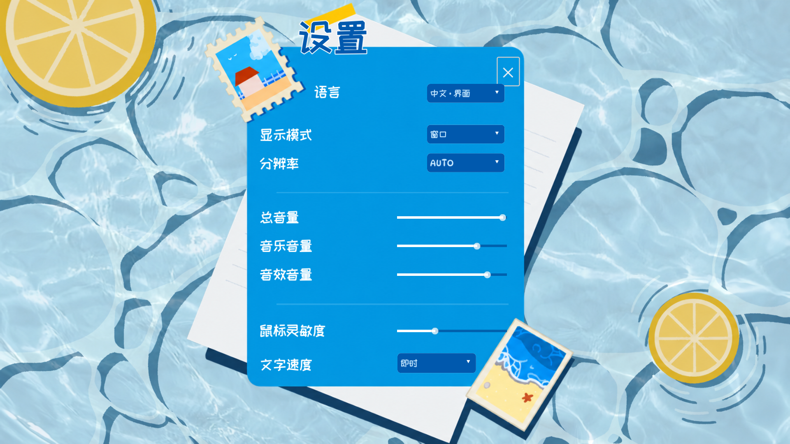
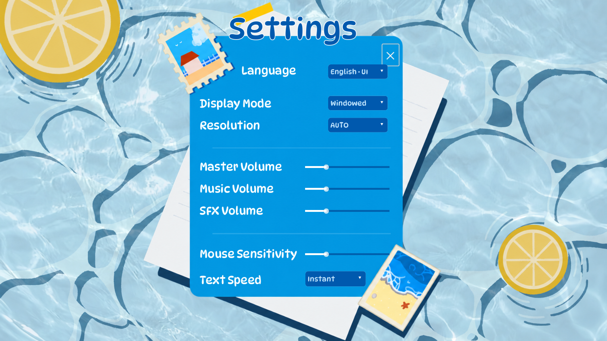
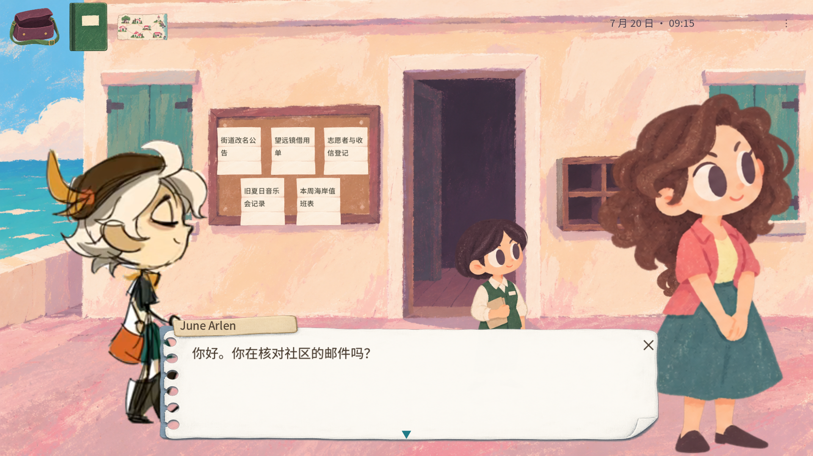

# 海岸设置与水纹融合复核 · 2026-10-17

按用户的水面、柠檬、纸张、邮票和蓝色设置卡片构图接入真实设置。静态美术分为两张经过检查的 ImageGen PNG，生成字节不重绘、不程序拼画；文字和控件由游戏实际排版。DynaPuff / 站酷快乐体保留 OFL1.1 商用兼容许可、固定版本及文件 SHA256。

最新反馈否定了上一版亮白水圈。已删除附加白环、发光和规则多圈，只对原有绘制水纹做少量不规则折射、扩散及衰减。菜单、文字、纸张和实体柠檬不动；纸面/柠檬不触发假水声，滑轨释放使用轻微干燥反馈。旧效果视频作为失败记录保留，不当成当前成果。

实际功能：中文/英文**界面**、窗口/全屏/无边框、Auto及三档分辨率、总/音乐/音效音量、纸面缩放平移灵敏度、对白文字速度。音量立即影响实际总线；灵敏度改变实际纸面缩放/移动，不改变系统鼠标或让拿起物件脱离指针。四条轨道直接拖动，设置原子保存并独立于剧情存档。所有模态有 × 和 Esc；下拉在本窗口内，避免原生弹窗焦点失效。原故事、信件内容保留原语言，选项明确标为 English · UI。

## 当前证据

- 最终源回归 `check-20261016-235932`：23 套件 / **7,951** 断言 / 0 失败；设置页219，笔记对话54，实际显示28，设置存取22，实物操作灵敏度6。两条完整五案路径及修改交付均实际跑完。
- 窗口关闭/恢复：29；制作流程 Python28；PNG/区域3；视频提取3；字体/水声文件3。三尺寸中英界面实际渲染。水纹前后像素检查验证真实水纹变化，纸面菜单及柠檬不变。
- [录屏](coastal-settings_20261016/settings-demo-1280.mp4)：真实 Godot MovieWriter 图像及混音，1280×720、24fps、144帧；自动输入水面点击、滑轨拖动、语言切换和叉号返回。它是引擎输入状态示范，**不是原生鼠标录像**。完整截图为1920×1080。
- R1 Windows 包的实际鼠标检查发现 F11 返回窗口后标签仍为 Full Screen。已修复为同一设置模型主动同步控件，并新增三尺寸回归。R1证据明确标为历史；其 Esc 检查被输入检测中断，不能记为通过。匹配R2包的原生结果另外记录。

## 已发现并修复

最初中文标签使用通用自动换行造成高大容器；改为测量实际字形、单行适配固定列。原生 PopupMenu 在引擎注入测试失焦；改为真实窗口内下拉。滑轨误用厚矩形背景，改为细线轨及足够点击面积。主管对白按钮改名产生旧焦点路径，改为构建前确定名称。旧测试期望“小人物在对话时仍显示”，与新参考的大立绘冲突；更新对应断言，同时检查实有人物且没有重复小人。R1实机 F11 标签滞后、用户指出假白圈分别修复，失败日志和旧视频不隐藏。

R2实际PCK解码298项、正式EXE启动120帧均通过；PCK SHA256 为 `ddb9d517e5d642a6d7cf51e4747e9f96ce944352dc607c5dd00cee6a580737f0`。两次退出仍记录18个ObjectDB与4个资源清理诊断，根因未定位。新版原生窗口确认重启读到英文界面和已保存滑轨值，并用实际点击打开设置；水面点击被其他输入检测打断，F11/Esc新版原生操作不记为通过。后来观察到窗口和设置值改变，不归因于本代理操作。两张原生图及明确边界见 native-r2/native.json；试玩窗口保留供实际使用。

代码/界面、美术、反向QA、音效来源和制作影响按顺序复核，是同一代理的具名责任检查，未启动49个代理，也不声称独立多人验收。主游戏剧情、原画外部文件、既有存档和协作者历史不改变。

## 验收边界

这次是当前UI和水纹反馈的开发交付。字体/水声来源和总线效果经过文件及实际触发检查；真人试听、新手盲测、完整原生矩阵、三封长信及真实火漆故事仍未完成。包退出仍需查看实际资源清理诊断，不能宣称全部游戏无bug或最高体验验收完成。`CORE-BOOK` 保持review。微信当前报告未发送，成果保留在源码、图片、视频及发布凭证中。
